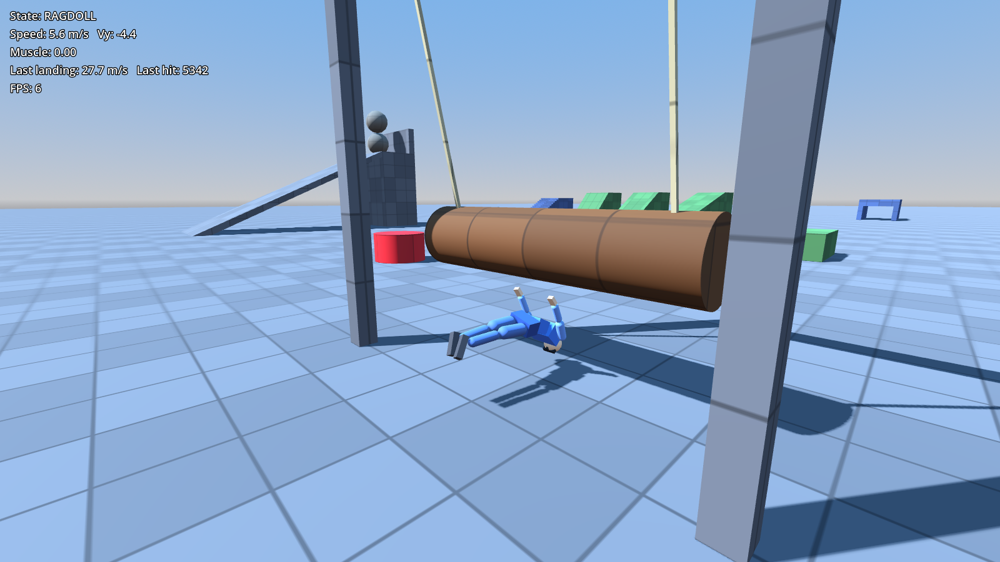

# rpg-test: movement prototype

A physics-driven third-person movement prototype for a future RPG, built with **Godot 4.5 + Jolt Physics**.
The character keeps momentum (walk, run, skid, crouch, slide, jump, forward roll) and is an **active ragdoll**.
It follows its animation tightly, wobbles when hit, and collapses into a full ragdoll on hard falls and hazards, then gets back up.



## Run it

**On a Mac** (Apple Silicon or Intel), one script downloads Godot 4.5.1 on first use and runs everything:

```
tools/crowd_mac.sh                # crowd test live: 100 NPCs, real rendering, real FPS overlay
tools/crowd_mac.sh live --npcs=1000   # 1000 NPCs (crowd layer); --characters makes all of them real characters
tools/crowd_mac.sh live-uncapped  # same with vsync off, to see headroom above the display refresh
tools/crowd_mac.sh measure        # simulation-only FPS (comparable with docs/performance.md)
tools/crowd_mac.sh video          # record out/crowd_mac.mp4 (brew install ffmpeg for .mp4)
tools/crowd_mac.sh game           # play the test level
tools/crowd_mac.sh tests          # full test suite
```

**Anywhere else:**

1. Install [Godot 4.5.x](https://godotengine.org/download) (standard build, no C# needed).
2. Open `project.godot` in Godot and press **F5**, or from a terminal run `godot --path .`.

| Action | Keyboard / mouse | Gamepad |
|---|---|---|
| Move | WASD | Left stick |
| Run | Shift | L3 |
| Jump (hold for height) | Space | A |
| Crouch (while running: slide) | Ctrl or C | B |
| Forward roll | Q | X |
| Punch | Left mouse / J | Y |
| Kick | K / V | Right trigger |
| Guard (hold) | Right mouse / L | Left trigger |
| Lift / drop, or grab to push and pull | E | RB |
| Throw a carried object | F | LB |
| Toggle ragdoll | G | D-pad down |
| Reset player | R | Back |
| Camera | Mouse (click to capture, Esc to release) | Right stick |
| Toggle help | F1 | |
| Show physics bodies instead of the mesh | F2 | |
| Tint characters by performance tier (LOD) | F3 | |

**Ledges:**
- **Mantle:** jump facing a chest-high ledge (0.6–1.6 m) and you climb straight onto it. A running jump into a ledge keeps some of your speed over the top.
- **Grab:** jump at a higher ledge (up to about 3.6 m from the ground) to grab it and hang.
- **While hanging:** A/D shimmies along the ledge and stops at its end. Jump or W climbs up. Crouch or S drops off.

**Combat** (the HUD names each reaction and its strength):
- **Punch:** a light, quick hit. It makes the target flinch, and the third punch in quick succession staggers them.
- **Kick:** a heavier hit that staggers. A kick with a run-up, or one landing while the target is already staggered or airborne, knocks them down into a ragdoll, and they get back up.
- **Guard:** blocks punches from the front. A kick breaks the guard and staggers you, and guard doesn't cover your back.
- Attacks turn you toward the nearest opponent in front of you. They aren't available while carrying or pushing something.

**Objects** (the HUD shows what E will do):
- **Lift:** objects up to 25 kg are lifted and carried in both hands. Carrying slows you in proportion to the weight. E drops the object; F throws it, and lighter objects fly further.
- **Push / pull:** objects from 25 to 300 kg are grabbed by the face you're looking at. W pushes and S pulls, and heavier objects move more slowly. E, jump or crouch lets go. Pulling stops at walls behind you.
- Anything heavier than 300 kg can't be moved.

**Tip:** press roll just before landing from a big drop to roll it out instead of ragdolling.

## Test level

The level is built in code by `scripts/main.gd`. It contains:
- **Ramps:** 15°, 30° and 45°.
- **Stairs**
- **Landing platforms:** 2, 5 and 10 m high, each with a ramp up.
- **Crouch tunnel:** ceiling at 1.5 m.
- **Jump gaps:** 2.5, 3.5 and 4.5 m.
- **Arena:** three training dummies (the same active-ragdoll character, tinted red): one stands still, one guards, and one spars with you. The sparring dummy closes in, alternates punches and kicks, and guards when you wind up. There's also a hanging punching bag.
- **Props yard:** a 4 kg box, an 18 kg sack, a 3 kg ball, an 80 kg crate, a 250 kg block and a 600 kg monolith.
- **Climbing area:** a 1.2 m mantle block, and an 8 m wide, 3 m tall wall to hang, shimmy and climb, with a higher ledge stacked on top.
- **Crate pyramid:** physics props.
- **Hazards:** a swinging log, a rotating sweeper bar (jump it), a red bumper, and a ramp that drops boulders.

## Architecture: proxy + puppet

```
PlayerController (CharacterBody3D capsule)   ← gameplay truth: input, momentum, FSM
  │  pose ctx (state, speed, phase, lean…)
  ▼
PoseGenerator  → per-bone target rotations (procedural, no animation assets)
  │   └ FootPlanner → planted feet + swing arcs (world ankle targets), step phase
  ▼
RagdollRig     → 16 RigidBody3D segments + Generic6DOFJoint3D (anatomical limits)
                 forward kinematics turns the pose into world targets;
                 each PuppetBone blends its velocity toward its target
                 scaled by muscle × stiffness × per-limb weakness
```

- **Proxy.** The `CharacterBody3D` handles all movement, so controls stay deterministic and responsive. This is the setup shipped games use. Balancing a character with physics alone is fragile.
- **Skin.** `HumanoidSkin` drives a skinned humanoid mesh from the puppet.
  - Each mapped skeleton bone takes its world rotation from its physics body.
  - Limb bones are aligned once from the model's A-pose to the puppet's rest pose.
  - Limb and neck bone heads are pinned to the puppet's joint pivots, so hands and feet are exactly where the physics contacts are. The spine is rebuilt down the hierarchy from the hips.
  - The puppet's joint positions match the model's proportions, so pinning doesn't visibly stretch the mesh.
  - Fingers, toes, shoulders and pelvis bones keep their rest pose relative to their parent.
  - F2 shows the physics capsules instead.
  - The model is the CC0 "3D Male Base Mesh" (Rigify bone names). Any mesh with the same bone names can replace it through `model_scene`. See `assets/characters/LICENSE.md`.
- **Puppet.** Physical bodies follow the proxy through velocity-based muscles. Arms swing with inertia, the body banks into turns, and props shove limbs around.
- **Muscle.**
  - `muscle = 1`: the puppet looks animated.
  - `muscle = 0`: full ragdoll.
  - A stumble briefly drops it to 0.35.
  - A limb hit by a prop goes limp for about half a second (partial ragdoll).
- **Ragdoll triggers.**
  - A landing faster than `ragdoll_land_speed` (about 5 m or more).
  - Summed contact hits from props or hazards above `ragdoll_hit_threshold`. Hit strength is relative speed × mass.
  - `apply_hit(dv, point)`, used by the bumper and available for future combat.
- **Get-up.** Once the body settles, the proxy snaps under the pelvis and muscles ramp back up to a crouch, then to standing.
- **Locomotion: foot placement** (`scripts/player/foot_planner.gd`). Legs aren't animated by angles. Each foot is either *planted* (locked to a world position, so it never slides) or *swinging* along an arc to a landing spot.
  - **Landing spot.** Predicted from the body's velocity and turn rate, so the foot lands under the hips half-way through its next stance. Turning, stopping and changing direction all come out of the same rule.
  - **Speed.** Cadence, step length, duty factor and swing height follow speed. Walking keeps steps within what the legs can span and always has a foot down (double support). Above about 2 m/s (1.9–2.2 with hysteresis) the gait switches to a run with a flight phase: the foot lands closer in and pushes off further behind, and the heel tucks up in the swing (up to 0.5 m at a sprint).
  - **Foot roll.** Feet roll heel-to-toe: a heel strike when walking, then the heel peels off and the foot pivots on the toe.
  - **Standing still.** Feet stay planted. Turning on the spot or drifting triggers corrective steps until they're back under the hips.
  - **Overreach.** A planted foot left far behind (turning around) steps right away instead of lunging.
  - **Legs.** Placed by two-bone IK (`_leg_ik` in `ragdoll_rig.gd`). The pelvis drops when a foot would be out of reach, which also gives the walk its natural low point at double support.
  - **Upper body.** The step phase drives a weight shift over the stance foot and a hip drop on the swing side (walking), a bounce and forward lean (running), hips turning with the forward leg and shoulders counter-rotating, and arms swinging against the legs with more elbow bend the faster you go. Arm swing gives way while attacking, guarding, carrying or pushing.
  - **What you see.** While calm, the skin shows the animation for legs and pelvis, so planted feet stay planted (the physics chain lags fast steps by a few centimetres), and a 50/50 blend for the upper body. A weakened (hit) limb shows pure physics, so impacts still wobble.
  - **Measuring it.** `tests/gait_probe.gd` prints foot slip, clearance, duty, cadence and pelvis height for stroll, walk and run.
- **Foot IK** (in `ragdoll_rig.gd`, after FK) for grounded poses outside locomotion (getting up, sliding). Each foot raycasts down to the ground under it.
  - The pelvis drops for the lower foot.
  - An analytic two-bone IK re-aims thigh and shin so each ankle lands at its own ground height, keeping the knee's bend direction.
  - Each foot tilts to the surface normal.
  - Results are smoothed to hide pops at step edges.
  - IK is on while grounded (ground, crouch, stumble, get-up), partly on during a slide, and off in the air or a roll.
  - Tunables: `ik_probe_up`, `ik_max_drop`, `ik_smoothing`.
- **Ledges** (in `player_controller.gd`, under "ledges").
  - Detection: forward rays find a wall, a downward ray finds the ledge top, and a capsule overlap test checks there's room to stand on top.
  - Ledge height relative to the feet picks the move: ground mantle, mid-air mantle, or grab and hang.
  - `LEDGE_HANG` pins the capsule under the edge and re-probes the ledge as it shimmies. `CLIMB` moves the capsule up first, then over the edge.
  - The puppet blends through hang → pull → crouch → stand key poses.
  - All tunables are in the "Ledges" group of `MovementConfig`.
- **Combat** (`scripts/combat/combat.gd`, a `CombatComponent` on every character).
  - Attacks have windup, active and recovery phases. During the active phase, sphere queries at the striking limb and the segment behind it hit other characters' puppet bodies, and props get an impulse.
  - Strength is the attack's base strength (punch 1.0, kick 2.2), boosted by run-up speed.
  - The receiver resolves the hit into a tier: BLOCKED (guarding, hit from the front, below the guard-break strength), GUARD BREAK, KNOCKDOWN, STAGGER, or FLINCH.
    - KNOCKDOWN: a strong hit, or a staggering hit while staggered, airborne, hanging, climbing or getting up. It reuses the ragdoll.
    - STAGGER: a medium hit, or the third light hit in a row.
    - FLINCH: the struck limb goes limp briefly and is knocked along the hit, plus a pose recoil. Movement continues.
  - Training dummies are `PlayerController`s driven by `DummyBrain` through the same external-input path the tests use.
  - Thresholds are in the "Combat" group of `MovementConfig`.
- **Objects** (in `player_controller.gd`, under "objects").
  - Carried objects are driven toward a hold point by a strength-limited force with gravity compensation. Collisions with the body are switched off while held and restored shortly after release.
  - Pushed or pulled objects get a strength-limited horizontal force applied low on the object, so friction doesn't tip it. The capsule follows the grab point, and contacts with the held object never count as hits.
  - Hand IK (two-bone, same solver as the legs) puts the palms on the object's sides or face.
  - All tunables are in the "Objects" group of `MovementConfig`.
- **Stairs.** The capsule rides a smooth invisible ramp through the step nosings (`proxy_only` layer). The treads are real colliders that only the puppet and foot IK see (`detail` layer), so the movement stays smooth while the feet land on each step.

### Physics layers

| Layer | Used by |
|---|---|
| 1 world | static level |
| 2 player_proxy | the movement capsule; collides with world, props and proxy_only |
| 3 puppet | ragdoll bodies; collide with world, props, hazards and detail, never with each other or the proxy |
| 4 props | crates, boulders |
| 5 hazards | kinematic log and sweeper |
| 6 proxy_only | collision only the capsule sees (smooth stair ramp) |
| 7 detail | collision only the puppet and foot IK see (stair treads) |

## Tuning

Every movement and ragdoll value is in `resources/movement_default.tres` (`MovementConfig`). Edit it in the Godot inspector. It covers:
- speeds and accelerations
- turn rates
- skid
- jump height
- gravity multipliers
- coyote time and jump buffer
- slide and roll
- landing thresholds
- hit thresholds
- get-up timing

Muscle stiffness gains are at the top of `scripts/player/ragdoll_rig.gd`. Per-bone stiffness, masses and joint limits are in `scripts/player/bone_def.gd`.

## Tests

```
tests/run.sh quick          # ~20 representative tests, a few seconds
tests/run.sh full           # everything, one process per group in parallel (~15 s on 4 cores)
tests/run.sh full combat    # only some groups: core, movement, terrain, objects, combat
GODOT=/path/to/godot tests/run.sh quick   # if godot isn't on PATH
```

A single process can also run a selection:

```
godot --headless --fixed-fps 120 --path . -s tests/run_tests.gd -- --suite=quick --group=combat --only=test_kick_stagger --list
```

Each test is registered in the `TESTS` table at the top of `tests/run_tests.gd` with its group and whether it's in the quick suite. `run.sh` prints a per-group summary and exits non-zero on any failure, crash or script error.

**CI** (`.github/workflows/tests.yml`) runs the quick suite on every push and the full suite on pull requests to `main`, using a cached Godot 4.5.1.

The suite has 151 deterministic gameplay checks. It covers:
- idle stability and joint-limit sanity
- walk and run acceleration and inertia
- skid
- variable jump height
- crouch under the tunnel ceiling
- skinned mesh tracking the puppet: joint positions and limb directions while idle, running and ragdolled
- combat: punch flinch with physical recoil, punch combo stagger, kick stagger and knock-back, knockdown with a run-up or on a staggered or airborne target, get-up afterwards, guard blocking from the front but not from behind, kicks breaking guard, the sparring dummy hitting the player and the player's guard blocking it, kicks hitting the bag harder than punches, no attacks while carrying
- objects: lift, carry while running, throw, drop, push and pull the crate, the heavier block being slower, the monolith being too heavy
- ledges: ground, running and mid-air mantles; grab, hang height and hand placement; shimmy and stopping at the ledge end; climbing up; dropping off without re-grabbing; out-of-reach walls
- gait: planted feet don't slide, swinging feet clear the ground and the hips stay up at stroll, walk and run; stopping settles both feet under the hips and then stops stepping; turning on the spot steps the feet round
- foot IK on a 30° slope and on stairs (feet on the surface and tilted to it, pelvis drop, stair climb without sinking)
- slide distance
- roll tumble
- stumble landing
- hard-fall ragdoll and get-up
- roll-landing save
- log and bumper knockdowns
- 30 s of random input with NaN and separation checks
- LOD: tiers by distance, frozen and parked puppets, promotion on hit, ragdolls staying FULL until they get up
- Crowd layer: baked animation size, nearest agents materialized up to the pool size, knockdowns in the crowd, characters returned to the pool, wandering and personal space

## Performance

See [docs/performance.md](docs/performance.md) for the benchmark (`tests/benchmark.gd`) and the character LOD tiers. In short:
- A fully simulated active-ragdoll character costs about 0.35 ms per 120 Hz physics tick on a 2.1 GHz cloud CPU.
- A budgeted LOD keeps only the nearest 5 characters fully simulated and the next 20 in a cheaper KINEMATIC tier; everyone else is PROXY_ONLY. Reduced tiers park their physics bodies and update at 30 Hz or 15 Hz, costing about 0.05 ms per character (7–9× cheaper).
- Hits, strikes and being run into promote a character back to full simulation instantly.
- **Crowd layer** (`scripts/crowd/`): NPCs as plain data drawn with chunked MultiMeshes and baked vertex animation. Only the 24 nearest become real characters, borrowed from a pool.
- **Crowd test** (`tests/crowd.gd --npcs=N`): the player sprints through a crowd, knocking some NPCs over. Simulation FPS on this cloud CPU (no rendering): 1000 NPCs at 105 FPS on average (99th percentile 65 FPS), 10,000 at 55 FPS. With every NPC a full character (`--characters`), 100 NPCs run at 66 FPS.

## Watching it without playing

`tests/showcase.gd` contains scripted clips (locomotion, movement, gait, falls, terrain, ledges, objects, combat, hazards) with captions. Record one to video with Godot's movie writer:

```
godot --rendering-driver opengl3 --resolution 1280x720 --write-movie clip.avi --fixed-fps 30 --path . -s tests/showcase.gd -- --clip=combat
```

## File map

```
project.godot                      Jolt, 120 Hz physics, layer names
scenes/main.tscn, player.tscn
scripts/main.gd                    level, player, camera, HUD
scripts/input_setup.gd             input actions (keyboard + gamepad), layer constants
scripts/player/player_controller.gd  movement + state machine
scripts/player/pose_generator.gd     procedural poses (crouch, slide, air, roll, get-up) + gait body motion
scripts/player/foot_planner.gd       locomotion: planted feet, swing arcs, cadence / stride / duty by speed
scripts/player/ragdoll_rig.gd        builds the puppet, FK targets, muscles, hit handling
scripts/player/puppet_bone.gd        per-body drive + contact hit detection
scripts/player/bone_def.gd           humanoid definition
scripts/player/movement_config.gd    tunables resource
scripts/camera/camera_rig.gd         orbit camera with spring arm
scripts/level/*.gd                   greybox helpers and hazards
scripts/ui/debug_hud.gd
tests/run_tests.gd
```

## Next steps toward the RPG

- Replace the procedural poses with authored animations, sampled as puppet targets, and give the character clothing and textures.
- Combat systems on top of the reactions: health, more moves, weapons, and enemy AI beyond the training dummies.
- Scale crowds further (see [docs/performance.md](docs/performance.md)): move the crowd update and the pose generator, FK/IK and drive to GDExtension, and give crowd agents ground queries so crowds can fill streets and stairs.
